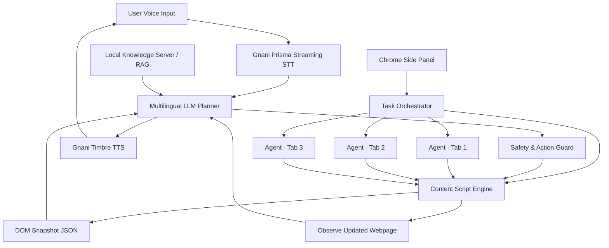

# 🎙️ Browse Voice

<p align="center">
  <strong>Browse the web. Understand everything. Get things done — in your own language.</strong>
</p>

<p align="center">
  An AI-powered, multilingual Chrome extension that transforms ordinary websites into intelligent, voice-accessible experiences.
</p>

<p align="center">
  <strong>Multilingual AI</strong> • <strong>Autonomous Browser Agents</strong> • <strong>Parallel Execution</strong> • <strong>Web Safety</strong>
</p>

---

## 🌍 The Problem

The internet is not equally accessible to everyone.

Most websites are designed primarily for English-speaking users. Millions of people in India are more comfortable communicating in their regional languages, making it difficult to:

- Understand complex website content.
- Navigate unfamiliar websites.
- Complete lengthy online forms.
- Interact with digital services independently.
- Perform multi-step tasks without technical assistance.

Even English-speaking users struggle with complicated interfaces, repetitive form filling, and navigating information-heavy websites.

**Browse Voice aims to remove these barriers by making the web accessible through natural voice interaction and intelligent browser automation.**

## 💡 Our Solution

Browse Voice is an AI-powered browser agent that understands spoken instructions, observes webpages, reasons about user intent, and performs browser actions.

Instead of simply converting speech into text, Browse Voice follows an intelligent agent workflow:

1. **Listen:** Understand the user's voice in supported Indian languages.
2. **Observe:** Inspect the active webpage and understand its DOM structure.
3. **Reason:** Use an LLM to understand the task and determine the next action.
4. **Act:** Interact with website elements, navigate pages, and complete supported workflows.
5. **Verify:** Observe webpage changes and determine whether an action succeeded.
6. **Respond:** Communicate progress and results through voice.

Users can also select specific webpage sections, ask contextual questions, check website authenticity, and delegate independent tasks to multiple agents working across different tabs simultaneously.

**Our vision is to make browsing the internet as simple as having a conversation.**

---

## ✨ Key Features

### 🗣️ 1. Multilingual Voice Interaction

Interact with websites naturally using your preferred language.

- Voice-based interaction in English and 10 Indian languages.
- Speech-to-text using Gnani AI's Prisma streaming STT.
- Natural voice responses using Gnani Timbre TTS.
- Conversational, multi-turn interactions.
- Browser speech synthesis fallback where configured.

**Supported languages:** English, Hindi, Bengali, Telugu, Tamil, Marathi, Gujarati, Kannada, Malayalam, Odia, and Punjabi.

### 🧠 2. Intelligent Webpage Understanding

Browse Voice understands the structure and context of the active webpage.

- Inspects webpages through injected content scripts.
- Extracts relevant DOM information.
- Identifies buttons, links, inputs, dropdowns, and other interactive elements.
- Uses numbered element references for accurate targeting.
- Observes dynamic webpage changes through MutationObserver.
- Generates webpage snapshots for contextual reasoning.

### 🎯 3. Visual Section Selection & Contextual AI

Ask questions about any specific section of a webpage without needing to explain where the information is located.

- Visually select a webpage section or element.
- Extract the selected section's relevant content and context.
- Ask questions about selected content using natural language.
- Summarize, explain, or analyze selected information.
- Maintain selected-section context during the ongoing conversation.

**Example:** Select a complicated electricity bill section and ask:

*"Explain this section in Marathi."*

### 🤖 4. Parallel Multi-Agent Browser Execution

Why execute tasks one after another when multiple agents can work simultaneously?

Browse Voice supports multiple independent agents working across different browser tabs.

- Assign different tasks to different agents.
- Execute independent workflows across multiple tabs in parallel.
- Maintain isolated task runners and tab-specific context.
- Coordinate execution through the Side Panel Orchestrator.
- Detect stuck workflows and prevent repetitive execution.

**Example:**

Ask Browse Voice to:
- Agent 1: Research electricity tariff information in one tab.
- Agent 2: Navigate an electricity payment portal in another tab.
- Agent 3: Extract relevant information from a third website.

Multiple independent workflows can progress concurrently rather than waiting for one task to finish before starting another.

### 🛡️ 5. Website Authenticity & Phishing Detection

Not every website on the internet is trustworthy.

Browse Voice includes website safety-checking capabilities to help users identify potentially suspicious or fraudulent websites.

- Inspect website domains and URLs.
- Identify potentially suspicious or phishing websites.
- Perform domain and website safety checks through the local knowledge backend.
- Provide safety-related information before users interact with unfamiliar websites.

**Example:** Ask:

*"Is this electricity payment website real or fake?"*

Browse Voice analyzes available website and domain safety signals to help users make informed decisions.

*Website checks provide risk indicators, not guarantees of legitimacy or security.*

### ⚡ 6. Autonomous Browser Interaction

Browse Voice goes beyond answering questions. It can execute browser workflows.

- Click buttons and links.
- Enter information into input fields.
- Interact with dropdowns and other form controls.
- Scroll through webpages.
- Navigate between pages.
- Handle multi-step tasks.
- Ask users for missing information when necessary.

### 📝 7. Intelligent Form Assistance

Make complex online forms easier to complete.

- Understand form fields using labels and surrounding DOM context.
- Match user-provided information with appropriate fields.
- Support multi-field form completion.
- Handle missing information through conversational clarification.
- Protect sensitive information from unnecessary exposure to the AI planner.

### 🔍 8. Webpage Context & Retrieval-Augmented Generation (RAG)

Provide the AI planner with additional website-specific knowledge.

- Cheerio-based webpage crawling.
- Local vector-store-based retrieval.
- Domain-specific knowledge retrieval.
- Website context supplied to the LLM planner.
- Additional domain and phishing safety checks.

### 🔐 9. Safety-First Browser Automation

Automation should never compromise user control.

Browse Voice incorporates:

- **PII Shield:** Redacts sensitive information such as passwords, OTPs, CVVs, and Aadhaar numbers.
- **Action Validation:** Validates structured planner output before browser execution.
- **Consequential Action Guard:** Requires user confirmation for sensitive operations such as payments.
- **Task Interruption:** Allows users to stop an ongoing workflow immediately.
- **Loop Detection:** Identifies repeated actions and potentially stuck workflows.
- **Structured Output Validation:** Uses strict JSON schema validation before executing planned actions.

---

## 🏗️ System Architecture

Browse Voice follows a modular, agent-based architecture consisting of four major layers.

### Architecture Diagram


### 1. User & Multimodal Interaction

The user interacts with Browse Voice through the Chrome side panel and floating agent interface.

**Components:**
- Microphone / Voice Input
- Speaker / Audio Output
- Floating Agent Badge
- Chrome Side Panel UI (React 19 + TypeScript)

### 2. Chrome Extension Runtime (Manifest V3)

The browser extension coordinates webpage interaction and task execution.

**Components:**
- Side Panel Orchestrator (`taskRunner.ts`)
- Multi-tab Task Decomposer
- Parallel Isolated Runners
- Background Service Worker
- Declarative Net Request Header Injection
- Tab Management
- Content Script Engine
- DOM Observer
- DOM Action Executor

This layer manages browser interactions and independent task execution across multiple tabs.

### 3. Intelligence & Safety Gateway

This layer converts user intent into executable browser actions.

**Components:**
- Multilingual LLM Planner (`lib/planner.ts`)
- Gnani Evon 3.3 Integration
- Indic Language Prompt Tuning
- Structured JSON Action Planning
- Strict JSON Schema Validation
- Safety & Consequential Action Guard (`safety.ts`)

The planner generates structured actions, which pass through safety validation before execution.

### 4. External Backends & Services

The system integrates external AI services and local website knowledge infrastructure.

**Components:**
- Gnani AI Cloud Services
- Prisma v3.0 WebSocket Streaming STT
- Timbre v3.0 Neural TTS
- Local Site Knowledge Server (Port 4001)
- Cheerio Web Crawler
- Local Vector Store (RAG)
- Domain & Phishing Safety Checker
- Target Website / Sandbox (Port 4000)

### Architecture Workflow



---

## 🧠 AI Model & LLM Flexibility

### Gnani Evon v3.3

Browse Voice uses **Gnani Evon v3.3**, developed by Gnani.ai, as one of its multilingual reasoning model options.

It is a hybrid Mamba2-Transformer Mixture-of-Experts model designed for strong Indic-language comprehension, reasoning, and instruction following.

**Model Highlights:**

| Specification | Details |
|---|---|
| Developer | Gnani.ai |
| Model | gnani-evon-v3.3 |
| Architecture | Mamba2-Transformer Hybrid MoE |
| Total Parameters | 30B |
| Active Parameters | ~3.5B per token |
| Context Window | 128K tokens |
| Precision | BF16 |
| Languages | English + 10 Indian languages |

### Why Gnani Evon v3.3?

Its Indic-language comprehension and reasoning capabilities make it particularly relevant to Browse Voice's objective of making web interaction accessible across Indian languages.

We leverage its multilingual reasoning capabilities to understand user instructions and support intelligent browser interactions.

### Model-Agnostic Architecture

Gnani Evon v3.3 is not the only model Browse Voice can work with.

The planner architecture is designed to support different LLM providers through configurable integrations.

Potentially supported model ecosystems include:

- Gnani Evon
- OpenAI
- Google Gemini
- Anthropic Claude
- Ollama
- Groq

Provider compatibility depends on the configured integration, API interface, and model capabilities.

**Our goal:** Build an extensible browser-agent platform instead of locking the entire system to a single LLM provider.

---

## 🔊 Voice Processing Pipeline

The voice interaction pipeline connects speech recognition, reasoning, browser execution, and speech generation.

```text
Microphone
    |
    v
Web Audio API
    |
    v
PCM Audio Processing
(Mono, 16 kHz, 16-bit)
    |
    v
Gnani Prisma Streaming STT
    |
    v
Multilingual LLM Planner
    |
    v
Safety & Action Validation
    |
    v
Browser Action Execution
    |
    v
Webpage Observation & Verification
    |
    v
Gnani Timbre TTS
    |
    v
Speaker Output
```

This pipeline enables natural voice interaction while allowing the agent to reason about and interact with the current webpage.

---

## 🛠️ Technology Stack

| Layer | Technologies |
|---|---|
| Browser Extension | Chrome Manifest V3 |
| Frontend | React 19, TypeScript |
| Build Tooling | Vite |
| Browser Interface | Chrome Side Panel API |
| Speech Recognition | Gnani Prisma STT |
| Speech Generation | Gnani Timbre TTS |
| Audio Processing | Web Audio API |
| AI Reasoning | Gnani Evon, OpenAI, Gemini, Claude-compatible integrations |
| Browser Automation | Content Scripts, DOM APIs |
| DOM Observation | MutationObserver |
| Backend | Node.js |
| Web Crawling | Cheerio |
| Retrieval | Local Vector Store, RAG |

---

## 🔐 Security & Reliability

Security is a core part of the Browse Voice architecture.

| Mechanism | Purpose |
|---|---|
| PII Shield | Redacts sensitive information |
| Action Validation | Validates planned browser actions |
| Consequential Action Guard | Requires confirmation for sensitive operations |
| Loop Detection | Identifies repeated or stuck workflows |
| Stop Controls | Allows immediate task interruption |
| Domain Safety Checker | Identifies potentially suspicious websites |
| JSON Schema Validation | Ensures structured planner output |

The objective is to build an autonomous browsing experience while keeping users in control of consequential actions.

---

## 🚀 Getting Started

### Prerequisites

- Google Chrome or a Chromium-based browser.
- Node.js 18 or newer.
- npm.
- Required API credentials for the selected AI and voice providers.

### 1. Clone the Repository

```bash
git clone https://github.com/ParagD1606/BrowseVoice.git

cd BrowseVoice
```

### 2. Install Dependencies

```bash
npm install
```

If the repository contains separate frontend and backend packages, install their dependencies in their respective directories.

### 3. Configure Environment Variables

Configure the required environment variables and API credentials for the selected integrations.

These may include:

- Gnani AI credentials.
- Selected LLM provider credentials.
- Backend service configuration.
- Local knowledge server configuration.

Refer to the project's environment example files and configuration modules.

**Never commit API keys or secret credentials to GitHub.**

### 4. Build the Extension

```bash
npm run build
```

Use the build command and output directory defined by the relevant package's `package.json`.

### 5. Load the Chrome Extension

1. Open `chrome://extensions/`.
2. Enable **Developer mode**.
3. Click **Load unpacked**.
4. Select the generated extension build directory.
5. Open a website and launch Browse Voice through the Chrome side panel.

### 6. Start Backend Services

Start the required local backend services using their respective package scripts.

The architecture includes:

- Local Site Knowledge Server (Port 4001).
- Target Website / Sandbox (Port 4000).

Ensure the required services and integrations are running before testing their corresponding functionality.

---

## 🎯 Example Use Cases

| User Instruction | Agent Workflow |
|---|---|
| "Explain this page in Hindi." | Extract webpage information and explain it in Hindi. |
| "Select this section and summarize it." | Analyze the selected webpage content. |
| "Is this website genuine?" | Inspect available domain and phishing safety signals. |
| "Fill in my electricity consumer number." | Identify the appropriate form field and enter supplied information. |
| "Find the payment button." | Inspect the DOM and locate the relevant element. |
| "Research electricity tariffs in another tab." | Assign an independent agent to the research task. |
| "Stop everything." | Interrupt ongoing browser workflows. |

---

## 🌟 What Makes Browse Voice Different?

| Traditional Voice Assistants | Browse Voice |
|---|---|
| Primarily answer questions | Can interact with webpages |
| Often operate through predefined commands | Uses LLM-based intent understanding |
| Limited webpage awareness | Observes webpage DOM context |
| Limited task execution | Supports multi-step browser automation |
| Often English-first | Designed around multilingual Indian users |
| Usually handle one workflow at a time | Supports parallel agents across tabs |
| Limited contextual selection | Supports selected-section conversations |
| Do not necessarily inspect website safety | Includes website authenticity and phishing checks |

Browse Voice combines multilingual AI, voice interfaces, webpage understanding, parallel browser agents, and safety mechanisms into one browser-native experience.

---

## 🔮 Future Scope

We envision Browse Voice evolving into a universal voice-accessibility and automation layer for the web.

Potential improvements include:

- Visual webpage understanding using screenshots.
- More robust dynamic form recognition.
- Better handling of authentication and multi-page workflows.
- Personalized user context and preferences.
- Expanded language and speech-provider support.
- Improved task recovery and execution verification.
- More advanced agent coordination and task delegation.
- Browser-wide accessibility for government, education, banking, and utility services.

---

## 👥 Team & Contributors

Built with the vision of making the internet more accessible, intelligent, and inclusive.

**Developer:** [Parag Dharamkar](https://github.com/ParagD1606)

**GitHub Repository:** [ParagD1606/BrowseVoice](https://github.com/ParagD1606/BrowseVoice)

---

## 🤝 Contributing

Contributions, suggestions, and improvements are welcome!

1. Fork the repository.
2. Create a feature branch.
3. Make your changes.
4. Test the extension and relevant backend services.
5. Submit a pull request.

---

## 📄 License

See the repository's LICENSE file for applicable usage and distribution terms.

---

<p align="center">
  <strong>Browse Voice — Making the web accessible, one conversation at a time. 🇮🇳</strong>
</p>

<p align="center">
  Built with ❤️ to break language barriers and make the internet more inclusive.
</p>
