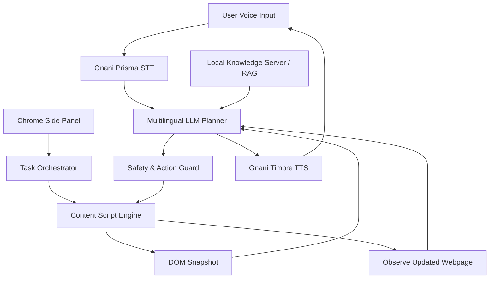

# 🎙️ Browse Voice — Your Voice-Powered Multilingual Browser Agent

<p align="center">
  <strong>Browse the web. Understand everything. Get things done — in your own language.</strong>
</p>

<p align="center">
  An AI-powered Chrome extension that transforms ordinary websites into voice-accessible, intelligent, and interactive experiences.
</p>

---

## 🌍 The Problem

The internet is not equally accessible to everyone.

Most websites are designed primarily for English-speaking users. Millions of people in India are more comfortable communicating in their regional languages, making it difficult to:

- Understand complex website content.
- Navigate unfamiliar websites.
- Complete lengthy online forms.
- Interact with digital services independently.
- Perform multi-step tasks without technical assistance.

Even English-speaking users struggle with complicated interfaces, repetitive form filling, and navigating information-heavy websites.

**Browse Voice aims to remove this barrier by allowing people to interact with the web naturally through voice.**

## 💡 Our Solution

Browse Voice is an AI-powered browser agent that understands spoken instructions, observes the current webpage, reasons about the user's intent, and performs browser actions.

Instead of simply converting speech into text, Browse Voice follows an intelligent agent workflow:

1. **Listen:** Understand the user's voice in supported Indian languages.
2. **Observe:** Inspect the active webpage and understand its DOM structure.
3. **Reason:** Use an LLM to understand the task and determine the next action.
4. **Act:** Interact with website elements, navigate pages, and complete supported workflows.
5. **Verify:** Observe the updated webpage and determine whether the action succeeded.
6. **Respond:** Communicate progress and results through voice.

The goal is simple: users should be able to operate websites without needing to understand their underlying complexity.

## ✨ Key Features

### 🗣️ 1. Multilingual Voice Interaction

- Voice-based interaction in English and supported Indian languages.
- Speech-to-text using Gnani AI's Prisma streaming STT.
- Natural voice responses using Gnani Timbre TTS.
- Designed for conversational, multi-turn interactions.
- Browser speech synthesis fallback where configured.

### 🧠 2. Intelligent Webpage Understanding

- Inspects the active webpage through injected content scripts.
- Extracts relevant DOM information.
- Identifies interactive elements such as buttons, links, inputs, and dropdowns.
- Uses numbered element references to help the agent identify targets.
- Observes webpage changes through MutationObserver.
- Supports webpage snapshots for contextual reasoning.

### 🤖 3. Autonomous Browser Interaction

Browse Voice goes beyond answering questions. It is designed to execute browser workflows.

- Click buttons and links.
- Enter information into input fields.
- Interact with dropdowns and other form controls.
- Scroll through webpages.
- Navigate between pages.
- Handle multi-step tasks.
- Ask the user for missing information when necessary.

### 📝 4. Intelligent Form Assistance

- Understand form fields using their labels and surrounding DOM context.
- Match user-provided information with appropriate fields.
- Support multi-field form completion.
- Handle missing information through conversational clarification.
- Protect sensitive information from being unnecessarily exposed to the AI planner.

### 🔍 5. Webpage Context & RAG

A local knowledge backend provides additional context for website understanding.

- Cheerio-based webpage crawling.
- Local vector-store-based retrieval.
- Domain-specific knowledge retrieval.
- Website context supplied to the LLM planner.
- Domain and phishing safety checks.

### 🛡️ 6. Safety-First Browser Automation

Browser automation should never sacrifice user control.

Browse Voice incorporates safety mechanisms such as:

- Sensitive information redaction for passwords, OTPs, CVVs, and Aadhaar numbers.
- Restrictions on automatically entering or submitting sensitive information.
- Confirmation gates for consequential actions such as payments.
- Immediate interruption through voice or stop controls.
- Loop and stuck-task detection.
- Validation of structured LLM planner responses before execution.

## 🏗️ System Architecture

Browse Voice follows a modular, agent-based architecture consisting of four major layers.

### 1. User & Multimodal Interaction

The user interacts through the Chrome side panel and floating agent interface.

Components:
- Microphone / Voice Input
- Speaker / Audio Output
- Floating Agent Badge
- Chrome Side Panel UI

### 2. Chrome Extension Runtime (Manifest V3)

The browser extension coordinates webpage interaction and task execution.

Components:
- Side Panel Orchestrator
- Multi-tab Task Management
- Background Service Worker
- Content Script Engine
- DOM Observer
- DOM Action Executor

The extension uses isolated task runners to manage browser workflows and prevent one task from interfering with another.

### 3. Intelligence & Safety Gateway

This layer converts user intent into executable browser actions.

Components:
- Multilingual LLM Planner
- Structured JSON Action Planning
- Context-Aware Reasoning
- Safety & Consequential Action Guard

The planner generates structured actions, which are validated before execution.

### 4. External Backends & Services

The system integrates external AI services and local website knowledge infrastructure.

Components:
- Gnani AI Cloud Services
- Local Site Knowledge Server
- Vector Store / RAG
- Target Website / Sandbox

### Architecture Flow



## 🧠 AI Model & LLM Flexibility

### Gnani Evon v3.3

Browse Voice uses **Gnani Evon v3.3**, developed by Gnani.ai, as one of its multilingual reasoning model options.

It is a hybrid Mamba2-Transformer Mixture-of-Experts model with:

- 30B total parameters.
- Approximately 3.5B active parameters per token.
- 128K context window.
- Support for English and 10 Indian languages.

Supported languages include:

Hindi, Bengali, Telugu, Tamil, Marathi, Gujarati, Kannada, Malayalam, Odia, Punjabi, and English.

Its Indic-language comprehension and reasoning capabilities make it particularly relevant to Browse Voice's goal of making web interaction accessible across Indian languages.

### Model-Agnostic Architecture

Gnani Evon v3.3 is not the only model Browse Voice can work with.

The planner architecture is designed to support different LLM providers, including:

- Gnani Evon
- OpenAI
- Google Gemini
- Anthropic Claude
- Ollama
- Groq

Provider compatibility depends on the configured integration and model capabilities.

**Why this matters:** We want Browse Voice to be an extensible browser-agent platform rather than an extension locked to a single AI model.

## 🔊 Voice Processing Pipeline

The voice interaction pipeline connects speech recognition, reasoning, browser execution, and speech generation.

```text
Microphone
    |
    v
Web Audio API
    |
    v
PCM Audio Processing
(Mono, 16 kHz, 16-bit)
    |
    v
Gnani Prisma Streaming STT
    |
    v
Multilingual LLM Planner
    |
    v
Browser Action Execution
    |
    v
Gnani Timbre TTS
    |
    v
Speaker Output
```

The streaming speech pipeline enables natural interaction without requiring the user to type every instruction.

## 🛠️ Technology Stack

| Layer | Technologies |
|---|---|
| Browser Extension | Chrome Manifest V3 |
| Frontend | React 19, TypeScript |
| Build Tooling | Vite |
| Browser Interface | Chrome Side Panel API |
| Speech Recognition | Gnani Prisma STT |
| Speech Generation | Gnani Timbre TTS |
| Audio Processing | Web Audio API |
| AI Reasoning | Gnani Evon, OpenAI-compatible LLM integrations |
| Browser Automation | Content Scripts, DOM APIs |
| DOM Observation | MutationObserver |
| Backend | Node.js |
| Web Crawling | Cheerio |
| Retrieval | Local Vector Store, RAG |

## 🔐 Security & Reliability

Safety is a core part of the architecture, not an afterthought.

Browse Voice incorporates:

- **PII Shield:** Redacts sensitive values before they are passed into the reasoning pipeline.
- **Action Validation:** Validates structured planner output before browser execution.
- **Consequential Action Guard:** Requires user confirmation for sensitive operations.
- **Task Interruption:** Allows users to stop an ongoing workflow immediately.
- **Loop Detection:** Identifies repeated actions and potentially stuck workflows.
- **Website Safety:** Uses domain and phishing checks as an additional safety layer.

The system is designed to keep the user in control of consequential browser actions.

## 🚀 Getting Started

### Prerequisites

- Google Chrome or a Chromium-based browser.
- Node.js 18 or newer.
- npm.
- Required API credentials for the selected AI and voice providers.

### Installation

Clone the repository:

```bash
git clone https://github.com/ParagD1606/BrowseVoice.git
cd BrowseVoice
```

Install dependencies:

```bash
npm install
```

Configure the required environment variables and provider credentials using the configuration files supplied with the project.

Build the extension:

```bash
npm run build
```

> Note: Build scripts and environment configuration can differ between project packages. Use the corresponding package.json and environment example files in each package.

### Load the Chrome Extension

1. Open `chrome://extensions/`.
2. Enable **Developer mode**.
3. Click **Load unpacked**.
4. Select the generated extension build directory.
5. Open a website and launch Browse Voice through the Chrome side panel.

Start any required backend services using their respective package scripts.

## 🎯 Example Use Cases

| User Instruction | Expected Agent Workflow |
|---|---|
| "Open the electricity bill website." | Navigate to the requested website. |
| "Explain this page in Hindi." | Extract relevant webpage information and explain it in Hindi. |
| "Find the consumer number field." | Inspect the DOM and identify the appropriate form field. |
| "Fill in my consumer number." | Match the supplied information to the relevant input. |
| "Scroll down and find the payment button." | Inspect and navigate the webpage. |
| "Stop." | Interrupt the ongoing task. |

These examples describe intended interaction workflows; individual actions depend on the website, available permissions, and configured integrations.

## 🌟 What Makes Browse Voice Different?

| Traditional Voice Assistants | Browse Voice |
|---|---|
| Primarily answer questions | Can interact with webpages |
| Often operate through predefined commands | Uses LLM-based intent understanding |
| Limited webpage awareness | Observes webpage DOM context |
| Often depend on fixed workflows | Supports dynamic task planning |
| Frequently English-first | Designed around multilingual Indian users |
| Limited browser task execution | Supports multi-step browser automation |

Browse Voice brings together voice interfaces, multilingual AI, webpage understanding, browser automation, and safety mechanisms in a single browser-native agent.

## 🔮 Future Scope

We envision Browse Voice evolving into a universal voice-accessibility layer for the web.

Potential improvements include:

- Visual webpage understanding using screenshots.
- More robust dynamic form recognition.
- Better handling of authentication and multi-page workflows.
- Personalized user context and preferences.
- Expanded language and speech-provider support.
- Improved task recovery and verification.
- Browser-wide accessibility for government, education, banking, and utility services.

## 👥 Team & Contributors

Built with the vision of making the internet more accessible, intelligent, and inclusive.

**Developer:** [Parag Dharamkar](https://github.com/ParagD1606)

## 🤝 Contributing

Contributions, suggestions, and improvements are welcome.

1. Fork the repository.
2. Create a feature branch.
3. Make your changes.
4. Test the extension and relevant backend services.
5. Submit a pull request.

## 📄 License

See the repository's license file for applicable usage and distribution terms.

---

<p align="center">
  <strong>Browse Voice — Making the web accessible, one conversation at a time. 🇮🇳</strong>
</p>
